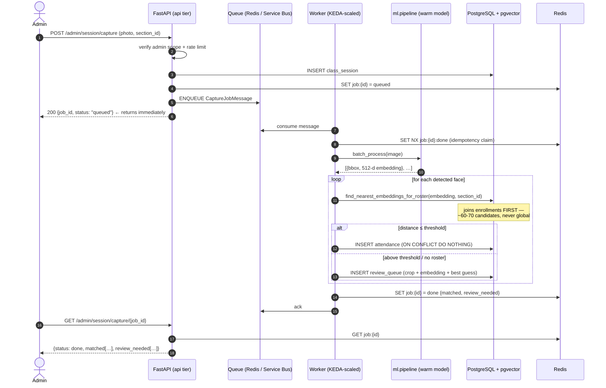
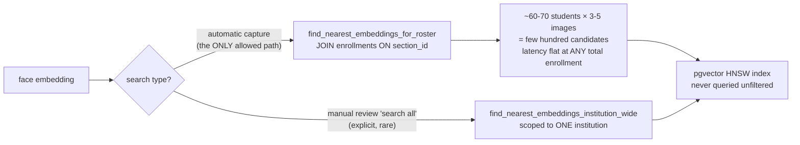
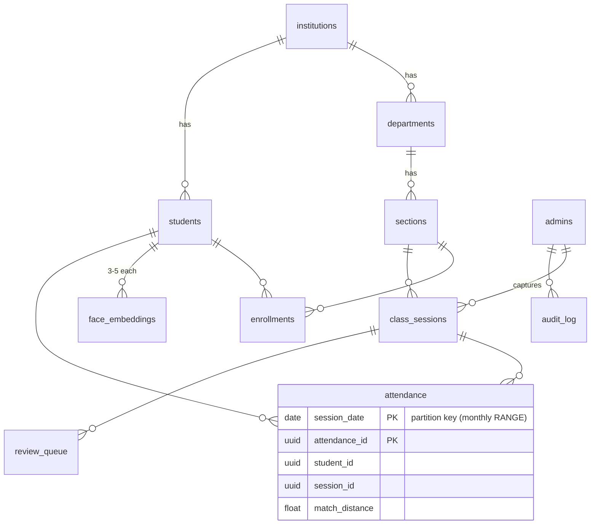

# docs/architecture.md
# System Architecture

## Overview

Multi-campus face-recognition attendance system supporting up to 50,000 enrolled
students across many institutions, departments, and sections.

## The Single Most Important Design Rule

> **Face matching for a class session is ALWAYS scoped to that section's enrolled
> roster (~60-70 candidates), never a global search across all enrolled students.**

This is what keeps match latency flat whether you have 5,000 or 50,000 students.
The pgvector HNSW index is never queried unfiltered. Every call to the vector index
is preceded by a join to `enrollments` filtered by `section_id`, reducing the
candidate set to ~60-70 embeddings regardless of total enrollment.

The one legitimate broader search — a faculty admin manually identifying an
unmatched face from the review queue — uses `find_nearest_embeddings_institution_wide`
which is explicitly named, expected to be slower, and used rarely.

## Organisational Hierarchy

```
Institution
└── Department
    └── Section (~60-70 students)
        └── Class Session
            └── Attendance / Review Queue
```

## Async Capture Flow

```
Admin uploads photo
        │
        ▼
POST /admin/session/capture
  ├─ Validate admin scope (must own the section)
  ├─ Store raw image to Blob Storage
  ├─ Enqueue CaptureJobMessage {job_id, session_id, section_id, image_url}
  └─ Return {job_id, status: "queued"} immediately
        │
        ▼ (async, separate process)
Worker consumes job
  ├─ batch_process(image) → list of embeddings
  ├─ For each embedding:
  │   └─ find_nearest_embeddings_for_roster(embedding, section_id)
  │       ├─ Match within threshold → INSERT attendance
  │       └─ No match             → INSERT review_queue
  └─ Update job status in Redis
        │
        ▼
Admin polls GET /admin/session/capture/{job_id}
  └─ {status: done, matched: [...], review_needed: [...]}
```

## Admin Role Hierarchy

| Role | Scope |
|---|---|
| `super_admin` | All institutions |
| `institution_admin` | One institution |
| `department_admin` | One department within an institution |
| `faculty` | Sections assigned to them |

JWT claims carry `institution_id` and `department_id`. Every admin route
validates the claim against the target resource — a department_admin for
Dept A gets 403 touching Dept B's sections.

## Key Diagrams

### Async capture flow (sequence)



### Roster-scoped matching rule



### Entity relationships



Also see the `ClassAttendenceResearch/Architecture/` directory for:
- System sequence diagram (async capture flow)
- Architecture block diagram
- Database ER diagram
- Internal service diagram

## Database Partitioning

The `attendance` table is partitioned by range on `session_date` (monthly).
At 50,000 students × 200 session-days/year ≈ 10M rows/year. Partitioning
ensures reporting queries only scan relevant months and vacuum overhead is
bounded per-partition.

A scheduled maintenance job pre-creates the next 3 months of partitions
to avoid missing-partition errors on first insert.

## Scalability Model

| Tier | Scale trigger |
|---|---|
| API | HTTP concurrency (Container Apps built-in) |
| Worker | Azure Service Bus message count (KEDA) |
| ML Inference | Queue depth (KEDA), min=0, scales to zero when idle |
| Database | Read replica for analytics, primary for writes |
| Cache | Redis for roster cache, rate limiting, job status |
